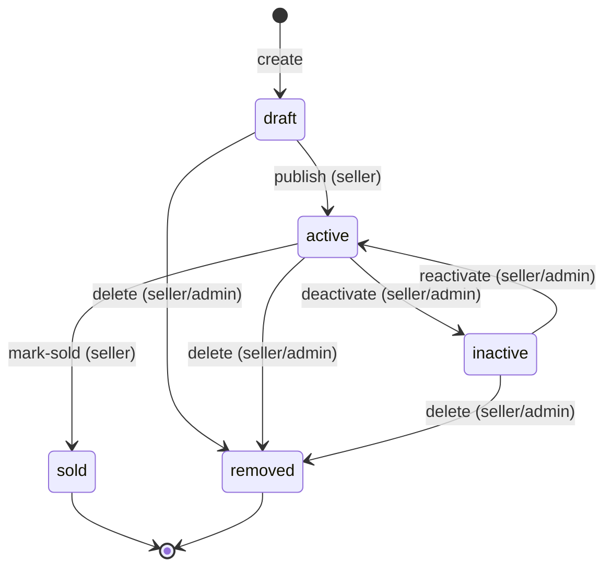
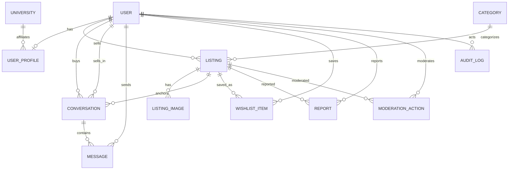

# 03 — Domain Model and Database Design

Primary key: `UUID` for all entities. Timestamps: `created_at`/`updated_at` (timestamptz, default `now()`). Soft deletion uses a status enum rather than a `deleted_at` timestamp where lifecycle matters; audit and history are preserved.

## 1. Entities

### User
- **Purpose:** The authenticated account.
- **PK:** `id UUID`.
- **Fields:** `email text` (unique, not null, lowercased), `password_hash text` (not null), `role enum(user_role)` (`student|admin`, default `student`), `status enum(user_status)` (`active|suspended`, default `active`), `email_verified_at timestamptz` (nullable), `created_at`, `updated_at`.
- **Constraints:** `UNIQUE(email)`; email stored lowercase.
- **Indexes:** none beyond PK/unique.
- **Ownership:** self (account).
- **Deletion:** never hard-deleted in MVP; suspend instead.
- **Authorization:** basis of all identity; role drives admin capability.

### UserProfile
- **Purpose:** Public-facing seller/profile info, separated from credentials.
- **PK:** `id UUID`.
- **Fields:** `user_id UUID` (FK→users, unique, not null), `display_name text` (not null, 1–80), `university_id UUID` (FK→universities, nullable — provisional), `profile_image_url text` (nullable), `bio text` (nullable, ≤500), `created_at`, `updated_at`.
- **Constraints:** `UNIQUE(user_id)` (one profile per user).
- **Indexes:** FK `user_id`; `university_id` for seller listings.
- **Ownership:** the linked user.
- **Deletion:** removed with account (or retained if account suspended).
- **Authorization:** public read of public fields only; write = owner.

### University *(provisional, OQ-1)*
- **Purpose:** Affiliation catalog.
- **PK:** `id UUID`.
- **Fields:** `name text` (unique, not null), `email_domain text` (unique, not null), `created_at`.
- **Constraints:** `UNIQUE(name)`, `UNIQUE(email_domain)`.
- **Ownership:** system-seeded.
- **Authorization:** public read.

### Category
- **Purpose:** Flat taxonomy for browse and listing assignment.
- **PK:** `id UUID`.
- **Fields:** `name text` (unique, not null), `slug text` (unique, not null), `sort_order int` (default 0), `created_at`.
- **Constraints:** `UNIQUE(name)`, `UNIQUE(slug)`.
- **Ownership:** system-seeded.
- **Authorization:** public read.

### Listing
- **Purpose:** A seller's offer of an item for sale.
- **PK:** `id UUID`.
- **Fields:**
  - `seller_id UUID` (FK→users, not null)
  - `category_id UUID` (FK→categories, not null)
  - `title text` (not null, 3–120)
  - `description text` (not null, ≤4000)
  - `price_minor integer` (not null, > 0, paise)
  - `condition enum(condition)` (`new|like_new|very_good|good|acceptable`, not null)
  - `quantity integer` (not null, default 1, ≥1, ≤100 proposed)
  - `status enum(listing_status)` (`draft|active|sold|inactive|removed`, default `draft`)
  - `version integer` (not null, default 1) — optimistic concurrency
  - `published_at timestamptz` (nullable), `sold_at timestamptz` (nullable)
  - `created_at`, `updated_at`
- **Constraints:** `CHECK (price_minor > 0)`, `CHECK (quantity >= 1)`, `CHECK (length(title) between 3 and 120)` (or enforced in app).
- **Indexes:** `(status, published_at DESC)` for browse; `(category_id)`; `(seller_id)`; full-text index on `title`/`description` (GIN tsvector); `pg_trgm` GIN on `title`.
- **Ownership:** the seller.
- **Deletion:** soft (`status = removed`); images and messages retained for integrity.
- **Authorization:** read = public if `active` (owner/admin for all statuses); write = owner or admin.

### ListingImage
- **Purpose:** Ordered images for a listing.
- **PK:** `id UUID`.
- **Fields:** `listing_id UUID` (FK→listings, not null, ON DELETE CASCADE on listing hard-delete only — soft delete does not cascade), `storage_key text` (not null), `url text` (not null), `position integer` (not null, ≥0), `created_at`.
- **Constraints:** `UNIQUE(listing_id, position)` (one image per slot).
- **Indexes:** `(listing_id)`.
- **Ownership:** via listing owner.
- **Deletion:** removed explicitly by owner; cascade only on true deletion.
- **Authorization:** public read (CDN URL); write = owner.

### Conversation
- **Purpose:** A private thread between a buyer and a seller about one listing.
- **PK:** `id UUID`.
- **Fields:** `listing_id UUID` (FK→listings, not null), `buyer_id UUID` (FK→users, not null), `seller_id UUID` (FK→users, not null), `created_at`, `updated_at`.
- **Constraints:** `UNIQUE(listing_id, buyer_id)` (one thread per buyer per listing); `CHECK (buyer_id <> seller_id)`.
- **Indexes:** `(buyer_id, updated_at DESC)`, `(seller_id, updated_at DESC)`.
- **Ownership:** both participants.
- **Deletion:** retained (history accessible to participants) even if listing removed; see §Relationships.
- **Authorization:** participants only.

### Message
- **Purpose:** A single message in a conversation.
- **PK:** `id UUID`.
- **Fields:** `conversation_id UUID` (FK→conversations, not null), `sender_id UUID` (FK→users, not null), `body text` (not null, ≤2000), `created_at`.
- **Constraints:** `CHECK (length(body) > 0)`.
- **Indexes:** `(conversation_id, created_at)` for chronological cursor.
- **Ownership:** sender (immutable).
- **Deletion:** never deleted in MVP (no edit/delete).
- **Authorization:** participants only.

### WishlistItem
- **Purpose:** A user's saved listing.
- **PK:** `id UUID`.
- **Fields:** `user_id UUID` (FK→users, not null), `listing_id UUID` (FK→listings, not null), `created_at`.
- **Constraints:** `UNIQUE(user_id, listing_id)`.
- **Indexes:** `(user_id, created_at DESC)`.
- **Ownership:** the user.
- **Deletion:** removed explicitly; retained when listing removed (shown "Unavailable").
- **Authorization:** owner only.

### Report
- **Purpose:** A user-reported listing for moderation.
- **PK:** `id UUID`.
- **Fields:** `reporter_id UUID` (FK→users, not null), `listing_id UUID` (FK→listings, not null), `reason enum(report_reason)` (`prohibited|misleading|spam|other`, not null), `note text` (nullable, ≤500), `status enum(report_status)` (`open|resolved|dismissed`, default `open`), `resolved_by UUID` (FK→users, nullable), `resolved_at timestamptz` (nullable), `created_at`.
- **Constraints:** `UNIQUE(reporter_id, listing_id)` (one report per user per listing, proposed).
- **Indexes:** `(status, created_at)`.
- **Authorization:** create = any signed-in user; read/resolve = admin.

### ModerationAction
- **Purpose:** Record of an admin moderation decision on a listing.
- **PK:** `id UUID`.
- **Fields:** `listing_id UUID` (FK→listings, not null), `moderator_id UUID` (FK→users, not null), `action enum(moderation_action)` (`deactivate|reactivate|remove`), `reason text` (not null), `created_at`.
- **Indexes:** `(listing_id)`, `(moderator_id)`.
- **Authorization:** admin only (append-only).

### AuditLog
- **Purpose:** Append-only record of security-relevant events.
- **PK:** `id UUID`.
- **Fields:** `actor_id UUID` (FK→users, nullable for system), `action text` (not null), `entity_type text` (not null), `entity_id UUID` (not null), `metadata jsonb` (nullable), `created_at`.
- **Indexes:** `(entity_type, entity_id)`, `(created_at)`.
- **Authorization:** write = system/backend; read = admin.

## 2. Listing lifecycle

- `sold` and `removed` are **terminal**.
- `draft`, `active`, `inactive` are non-terminal.
- **Actors:** `publish`, `mark-sold`, owner-`deactivate`, owner-`reactivate`, owner-`delete` = **seller**. Moderation `deactivate`/`reactivate`/`remove` = **admin** (recorded in `moderation_actions` + `audit_log`).

## 3. ER diagram

## 4. Data dictionary (summary)

| Table | Key columns | Notes |
|---|---|---|
| `users` | id, email(unique), password_hash, role, status, email_verified_at | Credentials isolated here |
| `user_profiles` | id, user_id(unique), display_name, university_id, profile_image_url, bio | Public info only |
| `universities` | id, name(unique), email_domain(unique) | Provisional |
| `categories` | id, name(unique), slug(unique), sort_order | Seeded |
| `listings` | id, seller_id, category_id, title, description, price_minor, condition, quantity, status, version, published_at, sold_at | Core offer |
| `listing_images` | id, listing_id, storage_key, url, position | unique(listing_id, position) |
| `conversations` | id, listing_id, buyer_id, seller_id, updated_at | unique(listing_id, buyer_id) |
| `messages` | id, conversation_id, sender_id, body, created_at | immutable |
| `wishlist_items` | id, user_id, listing_id | unique(user_id, listing_id) |
| `reports` | id, reporter_id, listing_id, reason, status, resolved_by, resolved_at | unique(reporter_id, listing_id) |
| `moderation_actions` | id, listing_id, moderator_id, action, reason | append-only |
| `audit_logs` | id, actor_id, action, entity_type, entity_id, metadata | append-only |

## 5. Relationships and ownership

- **User → Listings:** one-to-many; `seller_id`. Only owner/admin mutate.
- **User → Profile:** one-to-one.
- **Listing → Images:** one-to-many, ordered by `position`.
- **Category → Listings:** one-to-many.
- **User → WishlistItems:** one-to-many, unique per listing.
- **WishlistItem → Listing:** many-to-one; survives listing soft-removal (status surfaced to UI).
- **Conversation → Participants:** exactly two (`buyer_id`, `seller_id`).
- **Conversation → Messages:** one-to-many.
- **Listing → Conversations:** one-to-many (retained after sale/deactivation).
- **User → Reports/ModerationActions:** one-to-many.

**Conversation retention decision:** conversation history remains accessible to both participants after a listing is sold, inactive, or removed. This preserves the buyer–seller record for dispute resolution and continuity, and matches the requirement to define behavior for sold/inactive listings. Messages are never auto-deleted in MVP.

## 6. Example records (fictional)

`users`:
- `u-1` priya@univ.edu (student, active, verified)
- `u-2` arjun@univ.edu (student, active, verified)
- `u-3` maya@univ.edu (admin, active)

`listings` (seller arjun):
- `l-1`: "Engineering Mathematics 4th ed", price_minor 45000 (₹450), `very_good`, `active`, quantity 1, category "Books & Textbooks".
- `l-2`: "Dell Inspiron 15 laptop", price_minor 2200000 (₹22,000), `good`, `active`, quantity 1, category "Electronics".

`wishlist_items`: priya → `l-1`.

`conversations`: `c-1` (listing `l-1`, buyer priya, seller arjun), messages `m-1` (priya: "Is there highlighting inside?"), `m-2` (arjun: "No, clean pages.").

## 7. Migration strategy

- Prisma Migrate, migrations committed to the repo and applied idempotently (`prisma migrate deploy`) in CI/CD.
- One migration per schema change; no hand-editing of applied migrations.
- Soft-delete-first policy: destructive schema changes are staged and reviewed.

## 8. Seed-data strategy

- `categories` seeded from a fixed list (Books & Textbooks, Electronics, Furniture, Clothing & Accessories, Sports & Fitness, Stationery, Other — **flagged for confirmation**).
- One `university` seeded (provisional).
- `admin` seeded via `scripts/seed-admin.mjs` using an email from env (OQ-8), never a hardcoded password.
- Dev-only sample listings/accounts behind a non-production flag.

## 9. Ownership and authorization matrix

| Resource | Read (public) | Read (owner) | Create | Update | Delete/terminal transition |
|---|---|---|---|---|---|
| User/profile (self) | public fields only | full (self) | via register | self | — |
| Listing (active) | anyone | owner/admin | verified seller | owner/admin | owner (delete/mark-sold), admin (moderate) |
| Listing (draft/inactive/sold/removed) | none (404) | owner/admin | — | owner/admin | — |
| Images | anyone (URL) | — | owner | owner | owner |
| Conversation | — | participants | any user (buyer) | participants (send msg) | — |
| Message | — | participants | participant | — | — |
| Wishlist | — | owner | owner | — | owner (remove) |
| Report | — | admin | any user | admin (resolve) | — |
| ModerationAction / AuditLog | — | admin | admin | — | — |

Enforcement is always server-side (service layer), never trusted to the client.
