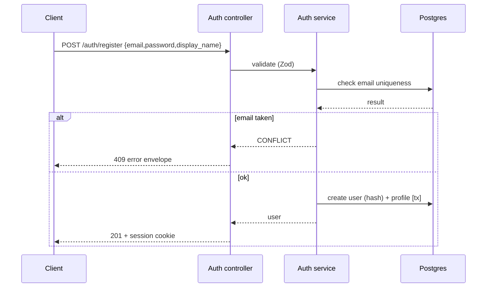
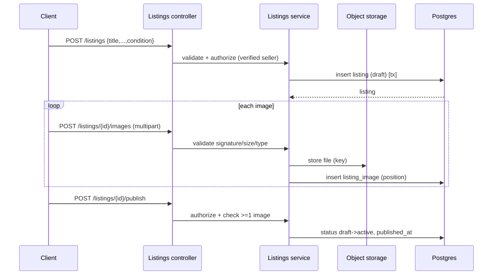
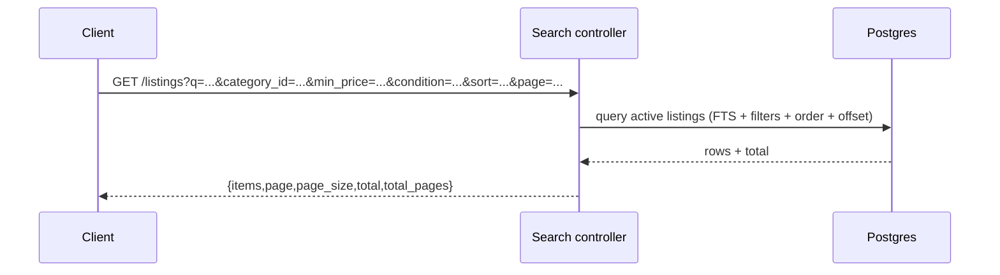
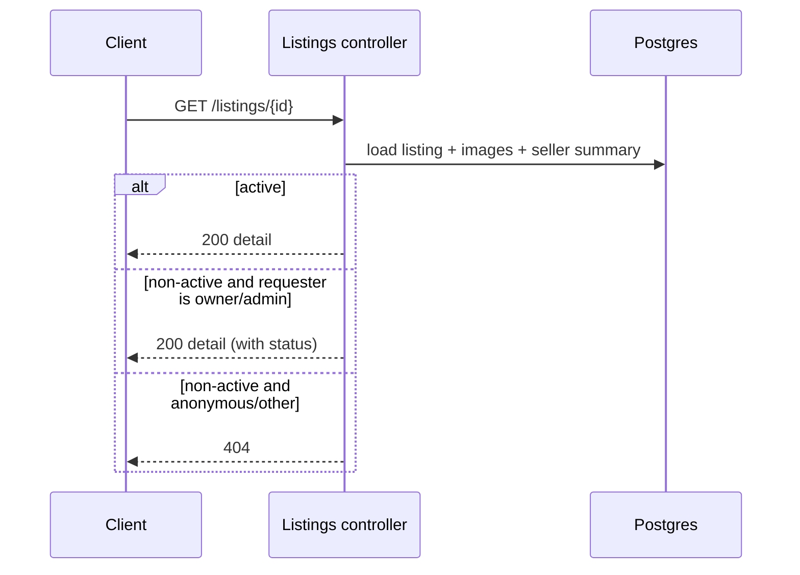
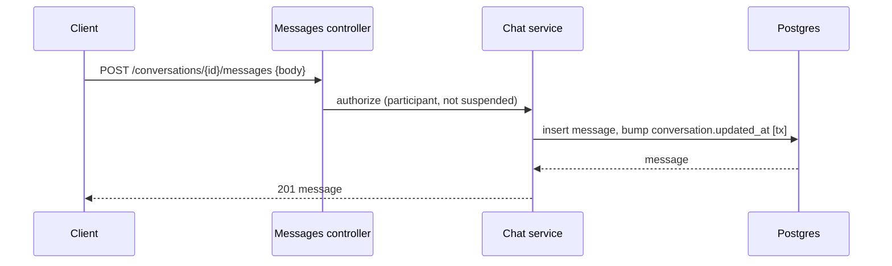
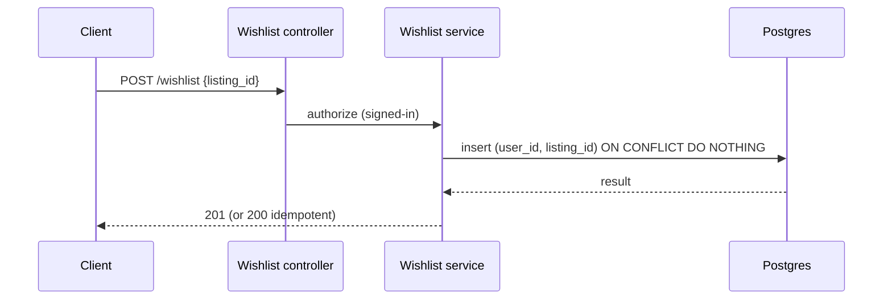
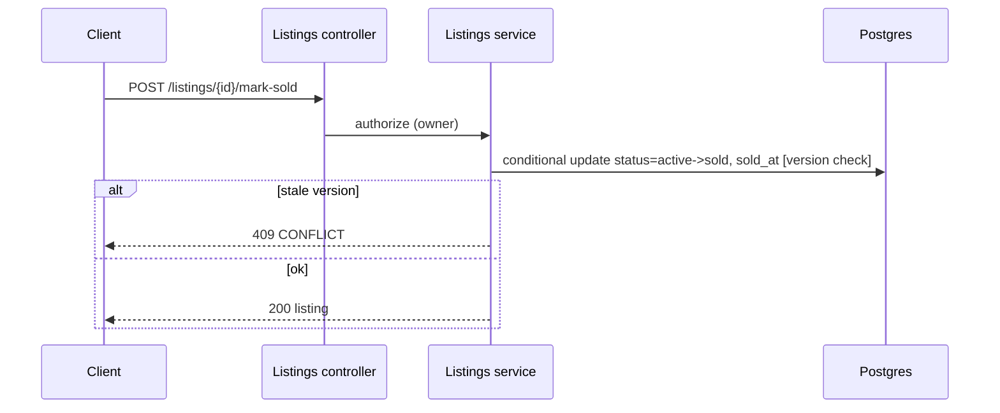
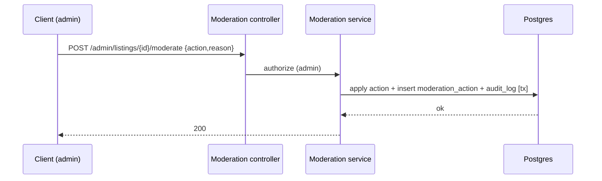

# 04 — System Architecture

## 1. Architecture choice

**Modular monolith** (one Next.js application) is selected (DEC-001). It is the simplest architecture satisfying the requirements: the MVP has ~10 bounded features, no independent scaling requirement, and no need for per-feature deployment isolation. Logical modules are enforced by directory structure and explicit module boundaries, not by network boundaries. This allows future extraction to separate services if a concrete requirement ever justifies it.

Alternatives considered and rejected for MVP:
- **Traditional monolith** (no module boundaries): meets requirements but risks a tangled codebase; the modular layout costs nothing extra.
- **Microservices:** unjustified — no team-isolation, independent-scaling, or polyglot requirements exist; it would multiply deployment and contract-drift risk without benefit.

## 2. Logical modules

| Module | Responsibility |
|---|---|
| Auth & accounts | Registration, login, session, roles, suspension |
| Profiles & affiliation | Public/private profile, university affiliation |
| Catalog & categories | Category taxonomy |
| Listings | Listing CRUD, lifecycle, images |
| Search & filtering | Query, filters, sort, pagination |
| Wishlist | Save/view/remove |
| Conversations & messaging | Threads, messages, participant authorization |
| Moderation | Reports, moderation actions, audit |
| Shared infra | DB client, config, validation, errors, logging |

Each module owns its entities, service functions, validation schemas, and API route handlers. Modules may call each other's **service functions** (never each other's HTTP handlers or DB tables directly), preserving boundaries while avoiding duplicated business logic.

## 3. Architecture decisions

| Concern | Decision |
|---|---|
| Frontend/backend boundary | Next.js App Router; React server/client components; API as route handlers under `/api/v1` |
| API layer | Route handlers = thin controllers → call module services → return JSON |
| Business logic | Service functions inside each module; validation with Zod at the boundary |
| Database access | Prisma (single client); repositories kept inside module service layer |
| Transaction boundaries | One Prisma `$transaction` per state-changing use case (e.g., create listing + attach images; mark sold; moderate) |
| Authentication | Auth.js v5 (Credentials) + Argon2id; JWT/session cookie (httpOnly, Secure, SameSite=Lax) |
| Authorization | Service-layer checks (role + ownership); never client-only |
| Image storage | Object storage (S3-compatible / Vercel Blob); DB stores key+URL+position; server-mediated write |
| Search | PostgreSQL FTS (`tsvector` + `ts_rank`) + `pg_trgm`; no dedicated engine |
| Messaging delivery | Database-backed polling (no WebSocket/SSE/broker) |
| Background jobs | None required in MVP |
| External integrations | None required beyond managed DB/storage (email provider only if OQ-7 verification enabled) |
| Error propagation | Central error mapper → error envelope (DEC-016) |
| Logging | Structured JSON logs; audit_log table for security events |
| Monitoring | `/api/v1/health`; optional Sentry for errors |
| Deployment topology | Single deployable (Vercel) + managed Postgres + object storage |
| Failure recovery | See `docs/failure-handling.md` |

**Not added (and why):** Redis (no caching/session-store need at MVP scale), message broker (no async work), worker service (no jobs), WebSockets (polling suffices). Each is documented as future scope only.

## 4. Synchronous vs asynchronous

- **Synchronous:** all request/response paths (auth, listing CRUD, search, messaging, wishlist, moderation).
- **Asynchronous:** none in MVP. (Email verification — if OQ-7 enabled — would be the first candidate for a background send, but can be synchronous at low volume.)

## 5. Data flows (sequence diagrams)

### 5.1 Registration and login

### 5.2 Create listing with images

### 5.3 Search and filter

### 5.4 Open listing detail

### 5.5 Send a message

### 5.6 Add to wishlist

### 5.7 Mark sold

### 5.8 Moderate a listing

## 6. Error propagation

Controllers throw typed domain errors → a central handler maps them to the error envelope (`docs/06-api-contract.md` §Error format). Unexpected errors are logged (no secrets) and returned as `INTERNAL` with no internals leaked.
